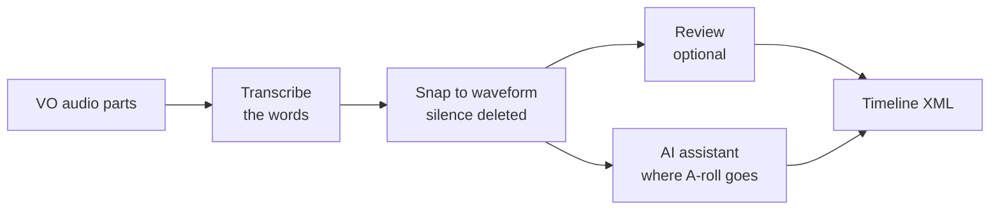

# Rainy

> A desktop tool for video editors that turns a writer's script, a voiceover and a pile of footage into a ready-to-edit Premiere Pro timeline. It runs on your computer, and an AI assistant you already use can drive it.

Rainy reads a `.docx` script, builds A-roll cards from it, links them to your footage, transcribes your voiceover, deletes the silence, and (with an AI assistant connected) decides where the A-roll goes and exports the timeline. It covers the same script-and-checklist ground as [Stratus](https://github.com/canefly/stratus), then goes much further: footage linking, voiceover cutting, and a live bridge for AI assistants.

> **Access note:** the official Rainy builds check in with a private license server, and every editor is approved personally before the app unlocks. The source is public so you can read it and learn from it, but it is not open source (see [License](#license-and-contact)). See [How access works](#how-access-works).

## What it does

### Script → A-roll cards
- **Parses `.docx` scripts.** A line with an `@editor` note and a timestamp becomes an A-roll card. Ranges (`0:01:36 - 0:01:49`) and single times both work.
- **Editor Notes.** Notes without a timestamp are collected into their own list, with filter, tick, jump-to-line and your own notes.
- **Source links.** Every link in the script is collected and checked off. Private Google Drive links can be read through your own browser cookies.
- **Frame-accurate times.** Once footage is linked, each time is conformed to the exact SMPTE frame of the clip, including variable-frame-rate footage.
- **Click a timecode to copy it.** Drag extracted images straight into Premiere or DaVinci.
- **Projects live on without the document.** Progress, notes and footage paths save into a `.rainyproj` file as you work.

### Clip player
- Loops each A-roll cut in a separate always-dark window (libmpv).
- **Edit mode** with `I` / `O` for In and Out, frame stepping, undo, reset to the writer's original times, and a zoomable timeline strip.

### Footage manager
- **Relink:** point Rainy at a folder and it matches your files to the script's links by file size.
- **Library:** every linked clip, with warnings for offline and variable-frame-rate clips and one-click re-encoding.
- **Transcribe:** voiceover to text with word timing, run locally with [faster-whisper](https://github.com/SYSTRAN/faster-whisper). Nothing is uploaded.
- **Review:** an optional quick pass over duplicate takes, false starts, wordless sounds and breaths, with a waveform player that previews the exact cut.

### Voiceover pipeline
> Whisper decides the words. The waveform decides the cuts. The AI decides, from the script, where A-roll goes. The editor decides which takes to keep. The audio file is never modified.



All silence is deleted, A-roll cuts only land on real gaps (never inside a word), and the exported timeline is `VO clip, VO clip, A-roll, VO clip…` with no slivers. Details: [docs/vo-pipeline.md](docs/vo-pipeline.md).

### AI assistants over MCP
- Rainy runs a local [MCP](https://modelcontextprotocol.io) bridge. One click in **Settings → MCP** installs it into **Claude Code, Claude Desktop, Codex, Antigravity, Gemini CLI, Cursor and VS Code**.
- The assistant reads your script and transcript, audits the voiceover against the script (exact, rephrased, ad-libbed, retaken, skipped), searches the project, and builds the timeline as FCP7 XML, or pushes it into a running Premiere Pro through its MCP server.
- You can watch every call live in **Settings → MCP → Live activity**, and switch the bridge off at any time.
- No long prompts needed: the tool carries its own instructions for the assistant. Details: [docs/mcp-settings.md](docs/mcp-settings.md).

### Look and feel
- Built on PySide6 and Fluent widgets, with light and dark modes.
- Five palettes: Femboy Pink, Cloudy Blue, Matcha Green, Adobe Gray (default) and OLED Black. The glassy ones support Windows 11 Acrylic/Mica; Adobe Gray and OLED Black stay solid.
- Optional on-device photo censoring that blurs graphic photos in scripts until you click them.
- An in-app user guide with search, a built-in updater (signed, hash-checked downloads) and a bug reporter that shows you exactly what it will send.

## How access works

Rainy is a private tool made by [canefly](https://github.com/canefly) for a small group of editors. The official build asks for the name you edit under, then waits for personal approval from a license server before it unlocks. What it sends for that, and what it does not, is spelled out in [`installer/agreement.txt`](installer/agreement.txt). Your scripts, footage and file names are never part of it.

The helper programs (libmpv, FFmpeg, FFprobe) are not bundled. After approval, Rainy downloads pinned builds and verifies each against a signed fingerprint. See [docs/app-folder.md](docs/app-folder.md).

## Developer notes (for reference)

These notes describe how the project is built and run in development. They are here so the code is easy to read, not as permission to run or redistribute it; see [License](#license-and-contact).

**Requirements:** Windows 10/11 x64, Python 3.10+.

```powershell
git clone https://github.com/canefly/Rainy.git
cd Rainy
python -m venv .venv
.\.venv\Scripts\pip install -r requirements.txt
```

Put `libmpv-2.dll`, `ffmpeg.exe` and `ffprobe.exe` in a `bin\` folder at the repo root, or have FFmpeg on your `PATH`. A source checkout looks in `bin\` first. Then start the app with the license gate skipped (this switch is only honored when running from source, never in compiled builds):

```powershell
$env:KNOT_SKIP_LICENSE = "1"
.\.venv\Scripts\python.exe src\main.py
```

Everything the app creates lives in `%LOCALAPPDATA%\com.canefly.knot\` (settings, engines, models, cache, logs), and your projects are in `Documents\Rainy\`. To point the app at a throwaway folder while developing, set `KNOT_HOME`.

### Tests

Some Qt test files crash when run together, so run them one file at a time:

```powershell
.\.venv\Scripts\python.exe -m pytest tests\test_vo_islands.py -q -p no:cacheprovider
```

### Build the installer

`scripts\build_installer.ps1` compiles the app with [Nuitka](https://nuitka.net/) and packages it with Inno Setup (both need to be installed). It also builds and self-tests the small `knot-mcp.exe` bridge. Output lands in `dist\`.

## Tech stack

- **UI:** PySide6 (Qt 6) with PySide6-Fluent-Widgets
- **Speech:** faster-whisper, with PyAV and FFmpeg for audio and video
- **Playback:** python-mpv (libmpv)
- **Integration:** a local MCP server (stdio JSON-RPC) talking to the app over a named pipe
- **Packaging:** Nuitka and Inno Setup
- **Storage:** SQLite in the app folder; the device key in the OS keyring

## Project layout

```
src/core/     parsing, timecode and frame math, VO islands and assembly, XML export,
              MCP server and installer, engines, updater, licensing client
src/ui/       main window, views, components (footage manager, clip player, settings)
assets/       logo and the bundled in-app guide pages
installer/    Inno Setup script and the installer pages' text
scripts/      Nuitka and installer build scripts
tests/        pytest suite
docs/         plain-language notes on the bigger features
```

## Documentation

- [Voiceover pipeline](docs/vo-pipeline.md): transcribe, snap, review, assemble
- [MCP settings](docs/mcp-settings.md): how AI apps connect, and what the page shows
- [Where the app keeps its files](docs/app-folder.md)
- [macOS port plan](docs/mac-porting-plan.md): planned, not built

## Status

Windows only for now. A macOS port is planned but nothing is built yet.

## License and contact

Rainy is made and owned by [canefly](https://github.com/canefly). The source is **public to read, not open source**: all rights reserved, no permission to copy, modify, redistribute or run your own copy. See [LICENSE](LICENSE). For bugs and questions, open a [GitHub issue](https://github.com/canefly/Rainy/issues).
