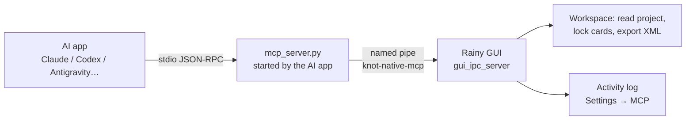

# MCP settings (Settings → MCP)

How AI apps (Claude, Codex, Antigravity, Cursor…) connect to Rainy, and what you can see and do from the **MCP** page in Settings.

**Status (2026-11-20):** built and tested, not committed. The connection test was run against the real MCP server; auto-install was tested on temp copies of each app's config, not by clicking Install on your real files.

## The page

The old **AI & MCP** item is now two items:
- **AI Models:** Whisper engine, speech models, photo censoring.
- **MCP:** the three cards below.

### 1. Live bridge

- **On / Off switch.** With the bridge off, every AI call is refused.
  - Fixed along the way: this switch never reached the main window before, because the settings window has no parent. It now goes through a `mcp_bridge_toggled` signal.
- **Badge:** `Listening` or `Off`. It shows the real state of the pipe server, not just the saved setting.
- **Test connection** starts the MCP server the way an AI app would, then checks three steps, each with its timing:
  1. **Start MCP server:** the handshake, and whether the instructions loaded.
  2. **List tools.**
  3. **Reach Rainy:** calls `get_workspace_status` and shows the project name. With no project open, this still passes ("Connected · no project open").
- **AI apps seen this session:** for each app, its name and version, when it was last seen, and how many calls it made.

### 2. Install in your AI apps

| App | File it edits | Format |
|---|---|---|
| Claude Code | `~/.claude.json` (user scope) | JSON `mcpServers` |
| Claude Desktop | `%APPDATA%\Claude\claude_desktop_config.json` | JSON `mcpServers` |
| Antigravity | `~/.gemini/config/mcp_config.json` (falls back to `~/.gemini/antigravity/mcp_config.json`) | JSON `mcpServers` |
| Gemini CLI | `~/.gemini/settings.json` | JSON `mcpServers` |
| Codex | `~/.codex/config.toml` | TOML `[mcp_servers.knot-tool]` |
| Cursor | `~/.cursor/mcp.json` | JSON `mcpServers` |
| VS Code | `%APPDATA%\Code\User\mcp.json` | JSON `servers` with `"type": "stdio"` |

**Row states:**

| State | Meaning |
|---|---|
| **Installed** | The entry points at this Rainy |
| **Needs update** | The entry points at another copy (moved folder, old install), or the app has it disabled |
| **Not installed** | The app was found but has no entry |
| **Not found** | The app doesn't seem to be on this computer; you can still **Install anyway** |
| **Can't read config** | The file isn't valid JSON/TOML; it's never written |

**What a write does:**
- It only touches our entry (`knot-tool`) and updates it in place rather than duplicating it. Entries from before the rebrand (`knot-tool`, `knot`) are not touched; remove them by hand.
- It saves `<file>.knot.bak` first, then replaces the file atomically.
- It sets `"disabled": false` if the app had turned the entry off.

**After installing,** restart the app (or reload its MCP servers) so it loads the new tools and instructions.

**What it launches:**
- **Dev:** the venv's `python.exe` with `src/core/mcp_server.py` (never `pythonw.exe`, because stdio needs a console Python).
- **Installed build:** `mcp\knot-mcp.exe` inside the install folder, a small separate program (about 9 MB, standard library only) built by `scripts/build_nuitka.ps1`, which checks that it answers `initialize` before the installer is made.

**Copy config JSON** gives the same entry for any other app.

### 3. Live activity

- Every call that reaches the pipe, newest first:

  | Column | Shows |
  |---|---|
  | Time | when the call arrived |
  | App | which AI app made it |
  | Tool | the tool name |
  | What happened | a one-line summary, e.g. `Locked 3 cards · 3/24 total` or `Exported Ep1.xml · 71 VO clips · 24 A-roll · 1 cut(s) snapped` |
  | ms | how long it took |

  - Errors are red.
  - "connected" lines (blue) show when an app starts its MCP server.
- **Click a line** to see the full request and reply JSON, cut at 20,000 characters.
- **Toolbar buttons:**
  - **Pause:** stops the list moving; calls are still recorded.
  - **Copy:** copies the log as text.
  - **Clear.**
- The log is kept in memory only, for the last 500 calls. It's empty again after a restart.

## How "which AI is talking" works

1. In `initialize`, the AI app sends its `clientInfo` (e.g. `claude-code`, `codex-mcp-client`, `antigravity`). `mcp_server.py` keeps it.
2. Every pipe request carries it as `client`.
3. After the handshake, the server sends one `__hello` in the background. Rainy then logs "X connected" before the first tool call.
4. `mcp_activity.client_label` maps raw names to friendly ones: Claude Code, Claude Desktop, Codex, Antigravity, Gemini CLI, Cursor, VS Code. An unknown app keeps its own name.

## Fixed along the way

**UTF-8 on stdio.** On Windows, a piped stdout uses the console code page (cp1252). The emoji in the SOP then crashed `initialize`, and the error reply had `id: null`, so the AI app waited forever.
- The server now forces UTF-8 on stdin and stdout.
- Error replies keep the request's id.
- Claude Code didn't hit this, probably because its environment already forces UTF-8. Other apps may not.

**Private pipe for tests.** `KNOT_MCP_PIPE` (env) points the MCP server at another pipe, so the tests never touch a running Rainy.

## Code

| File | What |
|---|---|
| [`src/core/mcp_activity.py`](../src/core/mcp_activity.py) | Activity ring buffer, client names, summaries, bridge state |
| [`src/core/mcp_installer.py`](../src/core/mcp_installer.py) | App targets, status / install / remove, TOML block editing, connection test |
| [`src/core/gui_ipc_server.py`](../src/core/gui_ipc_server.py) | Records every call, answers `__hello`, reports listening state |
| [`src/core/mcp_server.py`](../src/core/mcp_server.py) | Keeps `clientInfo`, sends it with each call, UTF-8 stdio |
| [`src/ui/components/mcp_settings.py`](../src/ui/components/mcp_settings.py) | The page |
| `tests/test_mcp_settings.py` | Install / update / remove per format, unreadable files, labels, summaries, ring buffer, pipe logging, the real connection test, the page |
