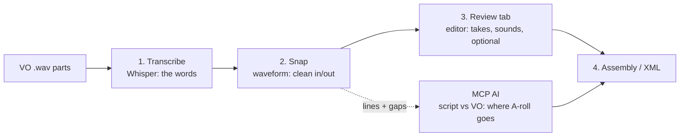

# Voiceover pipeline

How a VO audio file becomes narration clips in the exported timeline, and what each step is for.

**Status (2026-11-20):** all four steps are built, including the Review tab's quick player (zoom, scrub, cut preview) and phase 3 (the export uses the VO clips, snaps A-roll cuts, and the MCP speaks both clocks). Not yet tried end to end with a real AI session in Premiere. Nothing here is committed yet.

## The idea in one line

> **Whisper decides the words. The waveform decides the cuts. The AI decides, from the script, where A-roll goes. The editor decides which takes to keep. The audio file is never modified.**

This mirrors the manual edit: snipe each VO waveform, delete all the silence, and drop A-roll in where the script calls for it.

### Two layers

| Layer | Who | Job | Can it be wrong? |
|---|---|---|---|
| **Mechanical** | The engine (steps 2–3) | Find every speech island and give it a clean in/out. **All silence between islands is deleted, always.** Flag duplicate takes, false starts and wordless sounds. | Not about silence: it measures it. The flags are suggestions for you. |
| **Semantic** | The MCP AI (step 4) | Read the script against the transcript and decide **which gaps get A-roll**. A long VO pause inside one script block gets no A-roll: the gap is still deleted and the two VO clips sit right next to each other. | It can misread the script, which is why its cut points land only on real gaps. |

Example: VO islands `A ‖ B ‖ C ‖ D` (‖ = silence). All silence is deleted. The script puts A-roll after B, so the timeline becomes **`A B [A-roll] C D`**.

---

## Step 1: Transcribe (Footage & Media → Transcribe tab)

- Add the VO parts (Part 1, Part 2…) and press **Start queue**.
- Whisper transcribes each **whole file**, so it keeps sentence context.
- The timing of every word is kept.

Code: `VOBatchTranscribeWorker` in [`src/core/vo_engine.py`](../src/core/vo_engine.py)

## Step 2: Snap to the waveform (automatic, right after each part)

1. **Loudness map.** FFmpeg decodes the part in memory to mono 16 kHz. Loudness is measured every 10 ms and cached in `~/.knot_cache/vo_envelopes/`.
2. **Room tone.** The measured noise level of *this* file; your packs read about −102 dB. For detection the engine never assumes a floor lower than −90 dB, so dither and reverb tails on pitch-black VO don't count as speech.
3. **Speech islands = VO clips.** Runs of sound louder than *room tone + noise sensitivity* (default +12 dB).
   - Gaps shorter than 0.3 s (between words) don't split an island.
   - Blips shorter than 0.1 s are ignored as clicks.
4. **Clean in/out.** Each island keeps small handles, 40 ms before and 80 ms after, so a hard consonant or a word's tail isn't clipped. Handles never reach into the next island.
5. **Line snapping.** Each Whisper line's in/out moves onto island edges.
   - **Two lines in one island** (sentences separated only by a breath): they meet at the quietest point between them.
   - **No island nearby** (very quiet speech): the line keeps Whisper's times and is still **kept**. Transcribed words are never deleted as silence.
   - **Glued sentences:** a line Whisper glued across a ≥ 0.7 s pause is split.

The transcript JSON is **version 2**:
- `islands` and `detection` settings
- per part: `noise_floor_db` (the room tone)
- per line: `whisper_in` / `whisper_out`, `snapped`, `gap_after_sec`, and `words` (in the JSON only)

### Two clocks: don't mix them up

| Field | Meaning |
|---|---|
| `source_in` / `source_out` (lines), `in` / `out` (islands, VO clips) | Seconds **inside that part's audio file** (`source_file`) |
| `global_in` / `global_out` | Seconds on the **joined VO timeline** (Part 1 then Part 2…, part offset added) |

Code: [`src/core/vo_islands.py`](../src/core/vo_islands.py)

## Step 3: Review (Footage & Media → Review tab) — optional

**What it's for:** a quick human pass over the problems a script can spot but shouldn't decide alone. **Silence is not one of them:** it's always deleted, so it's never flagged. **Skipping review is always safe:** every sound with a waveform is kept.

| Flag | How it's found | Your choices | If you skip it |
|---|---|---|---|
| Duplicate take | Neighbouring lines ≥ 80% the same text | Take 1 / Take 2… / Keep all | Keep all |
| False start | A line is the abandoned start of the next one, or a phrase repeats inside one line ("and then he and then he walked") | Keep / Drop | Keep |
| No words | A loud island with no transcribed words (laugh, shout) | Keep / Drop | Keep |
| Breath | A short, quiet island with no words | Keep / Drop (or all at once) | Keep |

**Dropping something removes the whole thing, handles included,** so no tiny slivers are left behind.

**One slider: Noise sensitivity** (+6 to +40 dB above room tone, default +12). It updates live, without re-transcribing.
- Raise it if hiss or room tone is being kept.
- Lower it if quiet word tails are being cut.

Changing it re-snaps every line and pushes the new timings to the workspace.

**Quick player** (an extra check by ear and eye; it has no timestamps):
- **Waveform** of the selected part. **Greyed-out audio is deleted:** silence plus anything you dropped.
- **Playhead:** click or drag the waveform to move it. Dragging is silent; if something was playing, it pauses while you drag and resumes when you let go. Clicking a tinted region also selects its flag.
- **Zoom bar** under the waveform, like the A-roll refiner's:
  - squeeze the two grip handles together to zoom in, down to half a second across
  - drag the middle to pan
  - click the bar to jump there
  - double-click the bar, or press the zoom-out button, to see the whole part
  - the mouse wheel zooms around the playhead
- **Clip edges when zoomed** (30 s or less across): each VO clip's in/out is drawn as `[` `]` and its speech island as a dashed line. The space between them is the handle, so you can check that a "hmm" or a word tail is inside the clip. These are view only: to change them you use the slider or a drop.
- **Play / pause** (button or **Space**) plays from the playhead. The **Cut preview** switch picks what you hear:
  - **On (default):** FFmpeg renders this part's VO clips, butted together sample-accurately, into a temp WAV. You hear exactly what the timeline gets. It's rebuilt when the clips change and deleted when the dialog closes. Code: [`src/core/vo_cut_preview.py`](../src/core/vo_cut_preview.py).
  - **Off:** plays the original file straight through.
- **Selecting a flag** (list or ↑↓) zooms to it and parks the playhead 1 s before it. The row's own ▶ always plays the original file ±2 s, because a dropped take isn't in the cut.

**The rest of the tab:**
- **Readout,** for example: `room tone -102 dB · 71 VO clips · deletes 114.7 s of silence · drops 2.5 s you rejected`.
- **Filter chips:** All · Takes · No words · Breaths. Breaths are grouped into one row you can expand.
- **Keys:** **Space** play/pause · **↑↓** move · **K** keep · **D** drop · **1–9** pick a take. An undecided item shows its default as a **dashed** button.
- **Counts:** the tab reads `Review · N` and the footer reads `Voiceover ready · N to review`. All breaths count as one item.
- **Saving:** decisions save into the transcript JSON under `review`, together with a `summary` (clips, seconds deleted and dropped), keyed by stable flag ids.
- **Older transcripts:** version 1 transcripts are upgraded the first time the tab opens, and the stored room tone is re-measured from the waveform on every load.

Code: [`src/core/vo_review.py`](../src/core/vo_review.py) (rules, `compute_kept_ranges`, `cut_summary`) and [`src/ui/components/footage/review_stage.py`](../src/ui/components/footage/review_stage.py) (tab)

## Step 4: Assembly / XML export (the AI asks Rainy for the XML)

1. **Cut points.** From the VO clips, Rainy lists every place A-roll may go, in global time. Each one knows the line spoken just before it (`after_segment_id`).

   | Kind | Where | Cut / resume |
   |---|---|---|
   | `gap` | The deleted silence between two VO clips (including Part 1 → Part 2) | Cut at the clip's out, resume at the next clip's in |
   | `breath` | Two lines inside one VO clip, separated only by a breath | One point: the quietest spot between them |
   | `start` / `end` | Before the first or after the last VO clip | |

2. **The AI names lines, not seconds.** It matches the transcript to the script, then locks each A-roll card with `after_segment_id` = the last line before the A-roll. Rainy turns that into the exact seconds (`simulate_aroll_lock` returns them in `resolved_from_segments`).
   - `resume_segment_id` is only for skipping lines, such as a retake.
   - Raw seconds still work as a fallback.
3. **Snapping on export.** Every lock time is moved onto the nearest cut point, so A-roll can never split a word. Locks that had to move are listed in `snapped_cuts`, with how far they moved.
   - Several cards after the same line play back to back.
   - A resume past the gap skips that VO.
4. **The narration on A1 = the VO clips,** butted together (`VO Clip 1, 2…`), each pointing at its own part file. All silence is gone, and your review drops are gone. Gaps without A-roll just close up: `A B [A-roll] C D`.
   - **Frames:** clip edges round outward (in floors, out ceils), so the 40/80 ms handles are never trimmed. A breath split rounds to the nearest frame, so the two halves meet exactly.
5. **Narration ranges the AI sends itself** (`assembly_segments`) are also turned into VO clips, with their edges snapped.
6. **Skipped review:** `get_workspace_status` and `trigger_xml_export` report `open_review_flags` and a `review_note`. The AI says it in one line and **exports anyway**.
7. **Older transcripts** (version 1, no islands) still export the old continuous narration packs.

**What the export tells the AI:** `vo_mode`, `vo_clip_count`, `silence_deleted_sec`, `dropped_by_review_sec`, `snapped_cuts`, `open_review_flags`, `review_note`.

**The two clocks in the MCP:** `get_vo_segments` returns a `time_clocks` note and the `cut_points`. The SOP ([`src/core/instructions.md`](../src/core/instructions.md), section B2) explains with a table that lock times are always global, and that the AI's only timing job is choosing which gaps get A-roll.

Code: [`src/core/vo_assembly.py`](../src/core/vo_assembly.py) (cut model, cut points, snapping, MCP helpers), `build_default_assembly_segments_from_locks` / `generate_assembled_fcp_xml` in [`src/core/xml_exporter.py`](../src/core/xml_exporter.py), and the MCP handlers in [`src/ui/views/workspace_view.py`](../src/ui/views/workspace_view.py).

---

## Typical flows

**Careful day:** Transcribe → Review (pick takes, drop the junk) → ask the AI for the XML.

**"Skip that" day:** Transcribe → ask the AI for the XML. Silence is still deleted; every sound with a waveform is kept, and the AI mentions that review was skipped.

## Tests

| File | Covers |
|---|---|
| `tests/test_vo_islands.py` | Island detection and snapping, on generated audio with known gaps |
| `tests/test_vo_review.py` | Flag rules, VO clips (kept ranges), drops, cut summary, timing rebuild |
| `tests/test_vo_review_stage.py` | Review tab: load, decide, noise slider, greyed silence, keyboard, dialog badge, zoom, scrub, clip edges, cut preview playback |
| `tests/test_vo_cut_preview.py` | Source ↔ cut time mapping, and that the FFmpeg render is sample-accurate |
| `tests/test_vo_assembly.py` | Cut points, snapping, VO clips in the assembly, breath splits, skipped lines, review drops, XML frames, MCP helpers |
| `tests/test_gui_ipc_mcp.py` | Over the real MCP pipe: lock by line id, export VO clips, review note |
